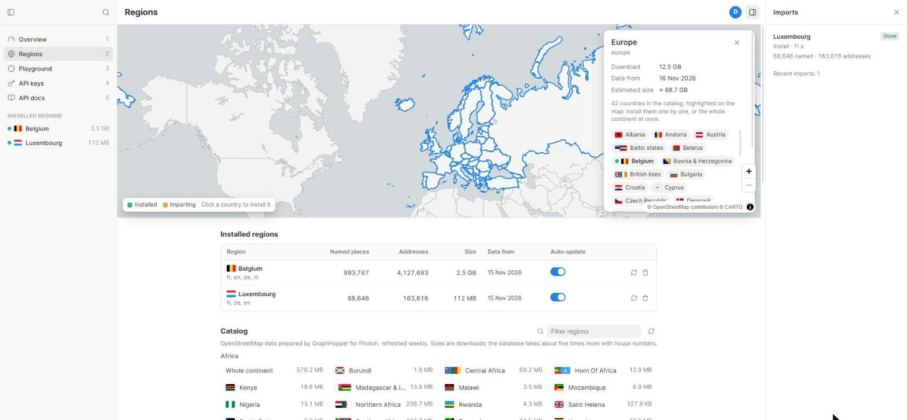
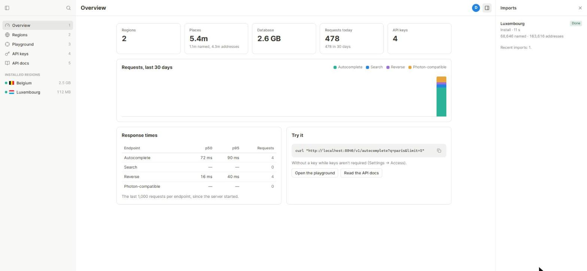
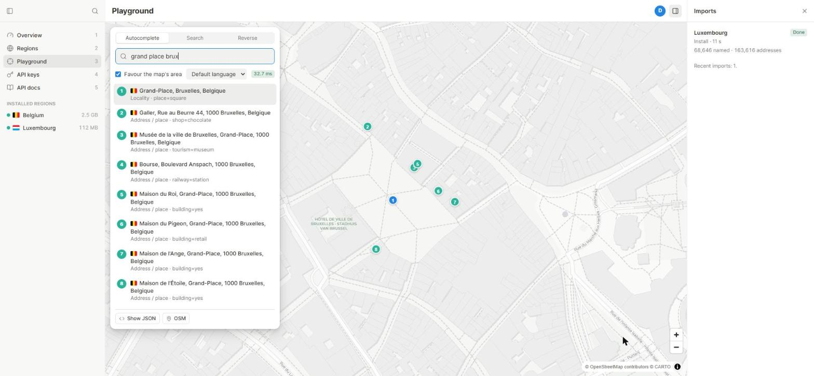
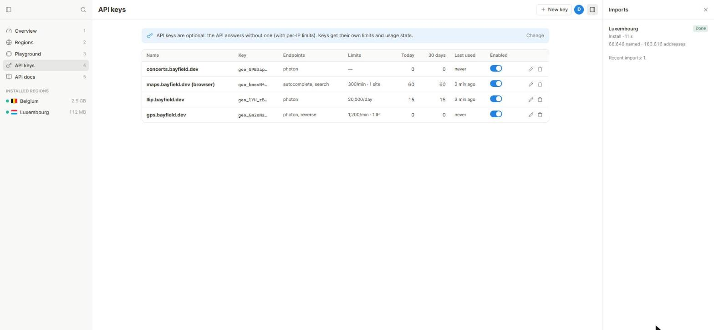
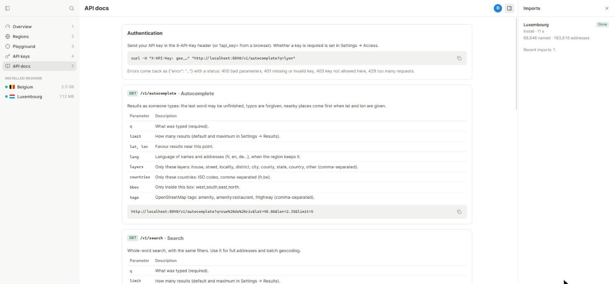
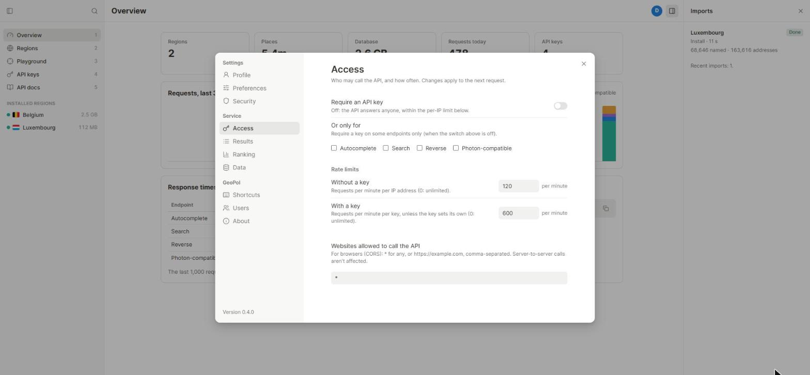
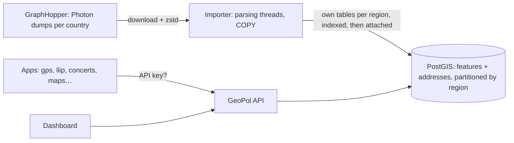

<div align="center">
  

  # GeoPol

  **Self-hosted geocoding for small servers: autocomplete, search and reverse geocoding on OpenStreetMap data, on PostGIS. Pick countries on a map, secure the API with keys, tune everything live.**

  [](#--disclaimer)
  [](LICENSE)
  [](https://react.dev)
  [](https://nodejs.org)
  [](https://postgis.net)
  [](https://geo.bayfield.dev)

  <br />
  <br />

  
</div>


## ⚠️ • Disclaimer

This is a personal project built for my own use, not a polished product: expect missing pieces, sharp edges, and breaking changes.


## 📋 • Table of Contents

- [📖 • Overview](#--overview)
- [📸 • Screenshots](#--screenshots)
- [🧩 • How It Works](#--how-it-works)
- [🔌 • API](#--api)
- [🛠️ • Tech Stack](#️--tech-stack)
- [🚀 • Getting Started](#--getting-started)
- [🔐 • Sign-in & Security](#--sign-in--security)
- [⌨️ • Keyboard Shortcuts](#️--keyboard-shortcuts)
- [❤️ • Health Check](#️--health-check)
- [📁 • Project Structure](#--project-structure)
- [🐳 • Docker Deployment](#--docker-deployment)
- [🙌 • Credits](#--credits)
- [📄 • License](#--license)


## 📖 • Overview

GeoPol replaces a Photon instance with something lighter to run and easier to control. It imports the same per-country OpenStreetMap dumps Photon uses (prepared by GraphHopper), into PostGIS instead of OpenSearch, and serves:

- **Autocomplete**: results as someone types (unfinished last word, typos forgiven, nearby places first)
- **Search**: whole words, with filters (layers, countries, bounding box, OSM tags)
- **Reverse geocoding**: the nearest address and street, and every area the point is in, from the actual boundaries (district → city → county → state → country)
- **Photon-compatible endpoints** (`/api`, `/reverse`): apps using Photon only change their URL
- **Four answer formats** on `/v1/…` (`?format=`): GeoPol's own, GeoJSON, Photon's GeoJSON, or a compact list

The dashboard is built like my other apps ([Calendar](https://github.com/PaulBayfield/calendar.bayfield.dev), [Notes](https://github.com/PaulBayfield/notes.bayfield.dev), [Llip](https://github.com/PaulBayfield/llip.bayfield.dev)): same header, sidebar, side panel, settings and update check. In it:

- **Regions**: click a country on the world map (or pick it in the catalog) to install it; GeoPol downloads and imports it in the background, with live progress, without slowing down the regions already served. Update or remove regions in one click; auto-update them weekly
- **Playground**: try autocomplete, search and reverse on a map, with timings and the raw JSON; hide a wrong result in one click
- **Custom places**: add places OpenStreetMap doesn't have (or names people use for ones it does), picked on a map; every endpoint finds them like the imported ones, and region updates never touch them. A place can be private: only the API keys you pick find it
- **API keys**: one per app, with allowed endpoints, requests per minute, daily quota, expiry, allowed websites and IP addresses, and usage stats. A switch decides whether keys are required (everywhere, on some endpoints, or not at all, with per-IP limits)
- **Settings, live**: access and limits, CORS, default and maximum results, layers, default language, ranking weights, synonyms (`st` ↔ `saint`), a blocklist (by OSM id or name pattern), the response cache (duration, size, hit rate), the default answer format, languages kept and house numbers for new imports, update schedule
- **Overview**: places served, disk used, requests over 30 days, response times (p50/p95)
- **API docs**, with examples pointing at your server


## 📸 • Screenshots

| | |
|---|---|
|  |  |
| **Overview**: places served, disk, requests over 30 days, response times | **Playground**: autocomplete, search and reverse on a map, with timings and the JSON |
|  |  |
| **Regions**: click a country or a continent to install it; imports run in the background | **API keys**: one per app, with endpoints, limits, allowed sites or IPs, and usage |
|  |  |
| **API docs**: every parameter, with examples pointing at your server | **Settings**: access, results, ranking and data, applied live |


## 🧩 • How It Works



- **Two tables**, partitioned by region: *features* (named things: countries, cities, streets, points of interest) and *addresses* (house numbers without a name, most of the data, only searched when a query has a number).
- **Imports without downtime**: a region goes into tables of its own, gets its indexes, then is attached in one quick step; the old version answers until then. Removing a region is a `DROP TABLE`.
- **Search**: full-text vectors (names weighted above the address), prefix matching on the last word, two tiers (the ~1% most important places in their own index first, then the long tail capped at a few thousand candidates), a trigram fallback for typos, and ranking by importance, name match and distance (tunable in Settings → Ranking).
- **Reverse**: nearest address (KNN), nearest street by its line, containing areas by their polygons (GiST).
- **Custom places** live in a partition of their own (region `custom`, OSM type `X`), so they share the indexes and every query path; imports and removals only ever touch a region's own partitions.
- **Response cache**: identical requests within the TTL are answered from memory (an LRU, `X-Cache: HIT`/`MISS`), after the access checks; emptied whenever settings, custom places, the blocklist or the regions change.

Benchmarks of the first prototype on Belgium (5.1 M places): [docs/spike.md](docs/spike.md). With parallel parsing, Belgium imports in about 2 minutes (2.6 GB with house numbers); autocomplete answers in 3–70 ms, reverse in 3–7 ms.


## 🔌 • API

| Endpoint | What |
|---|---|
| `GET /v1/autocomplete?q=` | As-you-type results. Also `limit`, `lat`+`lon` (favour nearby), `lang`, `layers`, `countries`, `bbox`, `tags`, `format` |
| `GET /v1/search?q=` | Whole-word search, same parameters |
| `GET /v1/reverse?lat=&lon=` | What's at a point. Also `radius` (m), `limit`, `lang`, `layers`, `format` |
| `GET /api?q=` | Photon-compatible search (GeoJSON) |
| `GET /reverse?lat=&lon=` | Photon-compatible reverse (GeoJSON, `radius` in km) |
| `GET /v1/status` | Regions served, whether a key is required (no key needed) |

Send a key in the `X-API-Key` header (or `?api_key=`). Errors: `400` bad parameters, `401` missing or invalid key, `403` key not allowed here, `429` too many requests. The dashboard's **API docs** page has every parameter, with examples.


## 🛠️ • Tech Stack

| Layer | Choice |
|---|---|
| Front end | React 19, TypeScript 7, Vite 8, MapLibre GL 6 (CARTO base maps), world-atlas |
| Server | Node 24 running TypeScript directly, Hono 4, worker threads for imports |
| Database | PostgreSQL 17 + PostGIS 3.5, `pg_trgm`, `unaccent`, full-text search (postgres.js) |
| Data | OpenStreetMap via Photon's JSONL dumps (GraphHopper) |
| Sign-in | OIDC (authorization code + PKCE) with Authentik |


## 🚀 • Getting Started

### Prerequisites

- Node.js 24 or newer
- PostgreSQL 17 with PostGIS (the `postgis/postgis:17-3.5-alpine` image)
- An OIDC provider (Authentik) for production; local development can skip it

### Running Locally

```sh
npm install && npm --prefix server install
docker run -d --name geopol-dev-db -e POSTGRES_PASSWORD=geopol -e POSTGRES_DB=geopol -p 5440:5432 postgis/postgis:17-3.5-alpine
cp server/.env.example server/.env   # PUBLIC_URL=http://localhost:8840, DEV_LOGIN_USER=demo
npm run server                       # API + dashboard on :8840 (after npm run build), or…
npm run dev                          # …the dashboard on :1490 with hot reload, proxying /api and /v1
```

Then sign in, open **Regions** and click a country. A dump already on disk can also be imported from the command line:

```sh
npm --prefix server run import -- belgium.jsonl.zst --region europe-belgium --name Belgium --path europe/belgium
```

### Environment Variables

Only what the server needs to start; everything else is set in the dashboard. See [`server/.env.example`](server/.env.example).

| Variable | Default | What |
|---|---|---|
| `PUBLIC_URL` | (required) | Where GeoPol is reachable |
| `PORT` | `8840` | HTTP port |
| `DATABASE_URL` | (required) | PostgreSQL + PostGIS |
| `OIDC_ISSUER`, `OIDC_CLIENT_ID`, `OIDC_CLIENT_SECRET` | (required) | Dashboard sign-in; redirect URI `${PUBLIC_URL}/api/auth/oidc/callback` |
| `OIDC_ALLOWED_GROUPS`, `OIDC_ADMIN_GROUPS` | (empty) | Who may sign in, who is admin |
| `CLIENT_IP_HEADER` | (unset) | Header with the visitor IP, for per-IP limits (`cf-connecting-ip`) |
| `DUMP_BASE_URL` | GraphHopper | Where the Photon dumps come from |
| `IMPORT_WORKERS` | cores − 1, max 8 | Parsing threads during imports |
| `DEV_LOGIN_USER` | (unset) | Local development sign-in; only on `http://localhost` |


## 🔐 • Sign-in & Security

- The dashboard signs in only through your identity provider (OIDC + PKCE); admins (first user, or `OIDC_ADMIN_GROUPS`) change regions, keys and settings, everyone else can look
- API keys are shown once; only their SHA-256 is stored. Keys can be limited to endpoints, websites (Origin) and IP addresses, with their own rate limit, daily quota and expiry
- Per-IP rate limits for requests without a key; CORS allow-list for browsers
- Strict Content-Security-Policy on the dashboard (only CARTO's map tiles from outside)


## ⌨️ • Keyboard Shortcuts

| Keys | Action |
|---|---|
| `Ctrl K` or `/` | Search |
| `1`–`6` | Overview, Regions, Playground, Custom places, API keys, Docs |
| `N` | New custom place (on that page), else new API key |
| `Ctrl B` or `\` | Toggle sidebar |
| `.` | Toggle side panel (imports) |
| `Ctrl ,` | Settings |
| `Esc` | Close / cancel |


## ❤️ • Health Check

`GET /api/health` answers `{"ok": true}` once the database responds. `GET /v1/status` lists the regions served.


## 📁 • Project Structure

```
geo.bayfield.dev/
├── src/                     # the dashboard
│   ├── components/          # OverviewPage, RegionsPage, PlaygroundPage, PlacesPage, KeysPage, DocsPage, MapCanvas, ActivityPanel, the shell, settings
│   ├── lib/                 # api, countries (map shapes ↔ catalog), i18n, settings, router…
│   ├── styles.css           # the shared shell stylesheet
│   └── geopol.css           # this app's views
├── server/
│   ├── src/
│   │   ├── geo.ts           # the public API (/v1/*, /api, /reverse)
│   │   ├── geocode.ts       # search, autocomplete, reverse, output formats
│   │   ├── access.ts        # API keys, rate limits, quotas, CORS, usage
│   │   ├── settings.ts      # live settings
│   │   ├── places.ts        # custom places
│   │   ├── cache.ts         # the response cache
│   │   ├── api.ts           # the dashboard's API
│   │   ├── import/          # catalog, jobs, importer (run.ts, worker.ts), Photon dump format
│   │   └── …                # index, config, db, auth, http, users, updates
│   └── scripts/import.ts    # command-line import
├── docs/spike.md            # the prototype's benchmarks
├── Dockerfile
└── docker-compose.yml
```


## 🐳 • Docker Deployment

```sh
cp .env.example .env               # POSTGRES_PASSWORD (openssl rand -base64 24)
cp server/.env.example server/.env # PUBLIC_URL, OIDC_*
docker compose up -d
```

The image is published to `ghcr.io/paulbayfield/geo.bayfield.dev` on every push to `main`. The compose file gives GeoPol a 4 GB memory budget (2.5 GB for PostGIS, 1.5 GB for the app with 2 import threads; the values for 8 GB are in its comments); plan disk for about five times each region's download with house numbers (France ≈ 8 GB, Germany ≈ 10 GB). Put it behind your reverse proxy at `https://geo.bayfield.dev → localhost:8840`.


## 🙌 • Credits

Made by [Paul Bayfield](https://github.com/PaulBayfield).

| | |
|---|---|
| [OpenStreetMap](https://www.openstreetmap.org/copyright) contributors | The data (ODbL) |
| [Photon](https://github.com/komoot/photon) and [GraphHopper](https://www.graphhopper.com) | The dump format and the dumps |
| [PostGIS](https://postgis.net), [PostgreSQL](https://www.postgresql.org) | Storage and queries |
| [MapLibre GL](https://maplibre.org), [CARTO](https://carto.com/basemaps) | Maps in the dashboard |
| [world-atlas](https://github.com/topojson/world-atlas) / Natural Earth | Country shapes for the region map |
| [Hono](https://hono.dev), [postgres.js](https://github.com/porsager/postgres), [React](https://react.dev), [Vite](https://vite.dev), [Lucide](https://lucide.dev) | |


## 📄 • License

Copyright (C) 2026 Paul Bayfield

This program is free software: you can redistribute it and/or modify it under the terms of the GNU Affero General Public License as published by the Free Software Foundation, either version 3 of the License, or (at your option) any later version.

This program is distributed in the hope that it will be useful, but WITHOUT ANY WARRANTY; without even the implied warranty of MERCHANTABILITY or FITNESS FOR A PARTICULAR PURPOSE. See the [GNU Affero General Public License](LICENSE) for more details.
